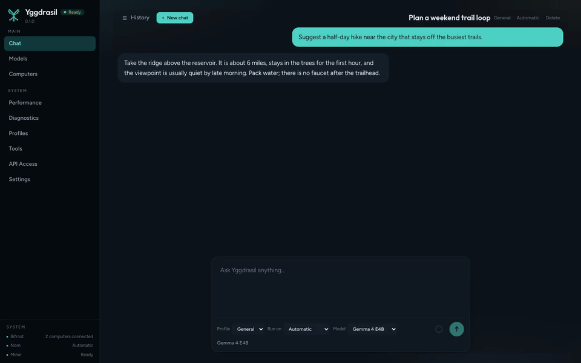
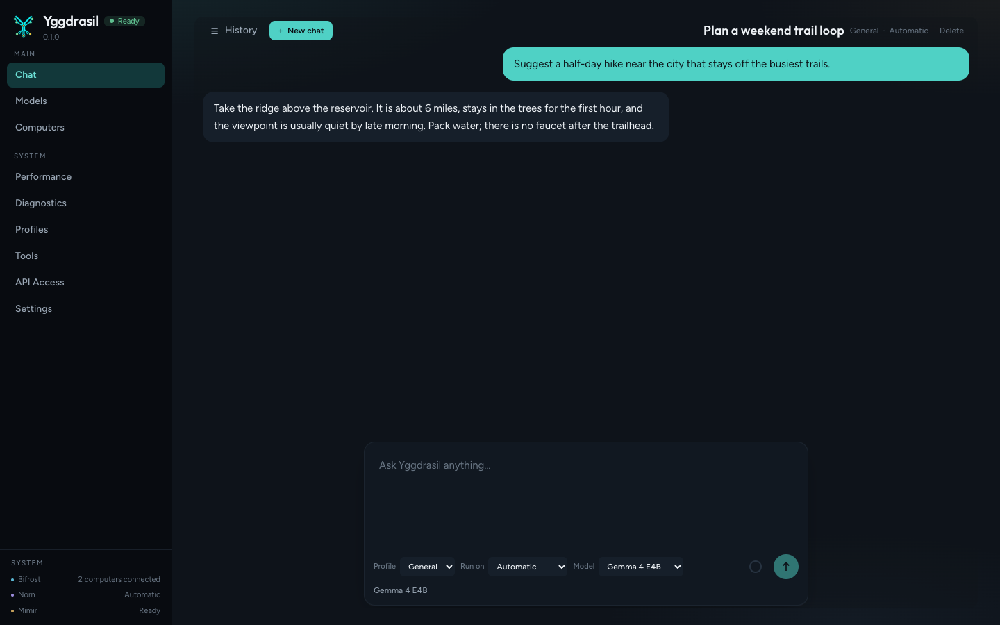
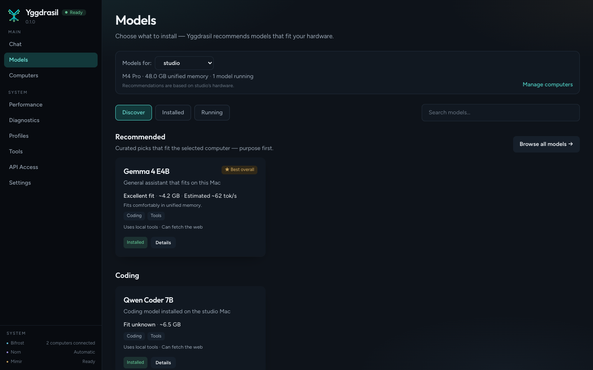
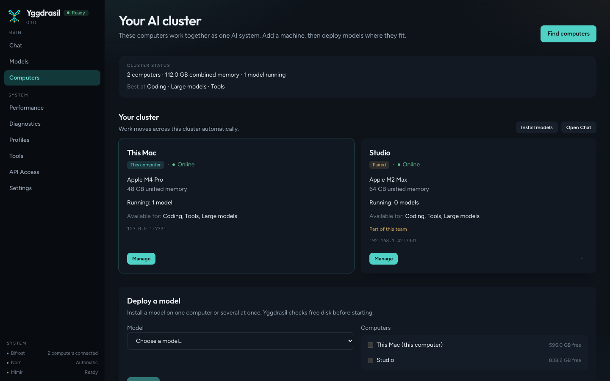
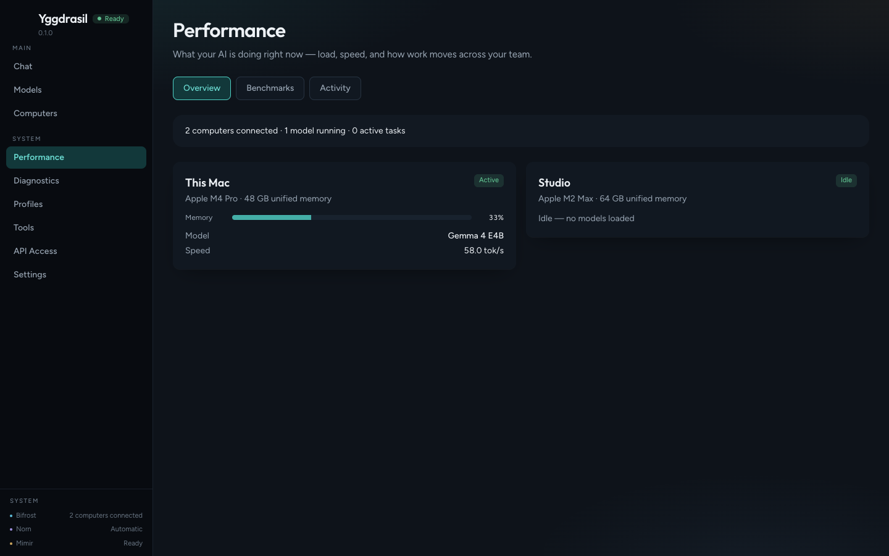
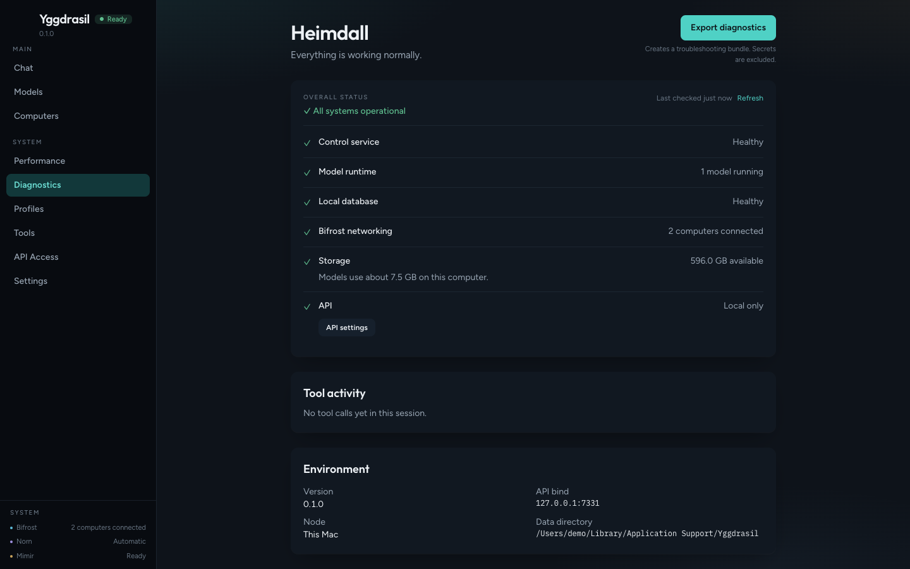
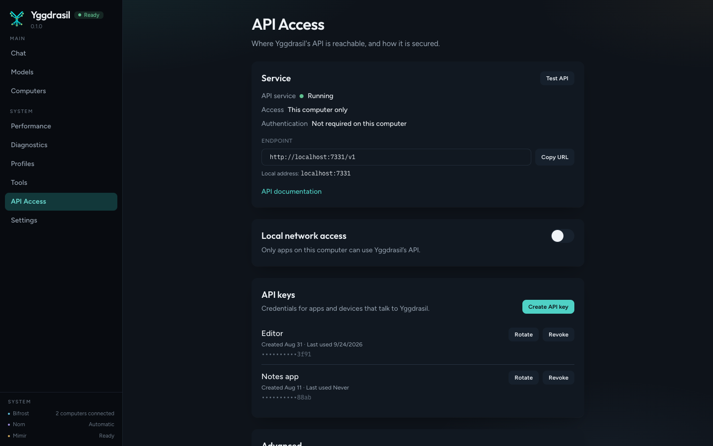

# Toskar Core

<p align="center">
  <picture>
    <source media="(prefers-color-scheme: dark)" srcset="docs/brand/logo/toskar-mark.svg">
    
  </picture>
</p>

<h3 align="center">Run local AI on every computer you own.</h3>
<p align="center">Toskar runs open models like Llama, Qwen, Gemma, Mistral, and DeepSeek <b>on your own Macs, PCs, and Linux machines</b>, not in the cloud.<br>It picks a model that fits, runs it on the computer that can handle it, and lets you manage models and access for everyone on your network.</p>

<p align="center">
  <a href="#quick-start"><b>Install</b></a> · <a href="#what-it-does">What it does</a> ·
  <a href="#run-it-for-your-household-or-team">For your network</a> ·
  <a href="#works-with-your-tools">Works with</a> · <a href="#supported-hardware">Hardware</a> ·
  <a href="#documentation">Docs</a> · <a href="CONTRIBUTING.md">Contribute</a>
</p>

<p align="center">
  <a href="https://github.com/yeixio/toskar-core/releases/latest"></a>
  <a href="https://github.com/yeixio/toskar-core/actions/workflows/ci.yml"></a>
  <a href="https://github.com/yeixio/toskar-core/actions/workflows/security.yml"></a>
  <a href="https://github.com/yeixio/toskar-core/actions/workflows/ci.yml"></a>
  <a href="LICENSE"></a>
  <a href="https://glama.ai/mcp/servers/yeixio/toskar-core"></a>
</p>

**Free and open source. No cloud, no account, and no usage telemetry by default.** By default, your prompts and files go to models on your hardware, never to an AI company; web search and outside services are there only if you turn them on. The daemon (`toskar`), the local web UI, and the HTTP API are in this repository.

<p align="center">
  <a href="docs/screenshots/demo.mp4">
    
  </a>
</p>

## What it does

Hosted AI is easy: pick a model, send a request, get an answer. Local AI usually means learning model formats, quantization, GPU backends, memory limits, ports, and which machine can run what. Toskar handles that part.

- **Picks models that fit.** It detects your CPU, GPU, and memory, shows which GGUF models fit, installs llama.cpp, downloads the model, starts it when needed, and unloads it when it sits idle.
- **Uses all your computers.** It finds other Toskar computers on your network, pairs with them after you agree, and sends each job to the machine that can run it: a model, the workers of a multi-step plan, an automation, or a training run. (Each model runs whole on one computer. Toskar does not split one model across machines.)
- **Manages AI for everyone on your network.** Like Rancher, but for AI models: one admin decides which models, profiles, and tools each person gets, and everyone else just signs in and chats. See [Run it for your household or team](#run-it-for-your-household-or-team).
- **Chooses a model per request.** With **Auto**, quick questions, coding, current information, and detailed work each go to a model suited to them, with a retry on another model when one fails.
- **Does more than chat.** Persistent memory, knowledge from your files, PDFs, and databases, tools with Allow / Ask / Deny permissions, MCP servers, scheduled automations, and LoRA training on your own examples.
- **Speaks your language.** The web UI comes in 10 languages: English, Deutsch, Español, Français, Italiano, Português, 日本語, 한국어, 简体中文, and 繁體中文.

## Run it for your household or team

One computer can serve AI to everyone on your network, whether that's a family, a home lab, or a small office. Toskar keeps their chats separate and lets you control what each person can use:

- **People and roles.** Add people as Owner, Admin, Member, or Visitor. They sign in with a password or invite link, your OpenID Connect provider, or a reverse proxy such as Authelia, Authentik, Cloudflare Access, or Tailscale.
- **Private by person.** Each person's chats, memories, files, and automations are theirs alone.
- **Control what people use.** Admins pin people or roles to specific profiles, and turn files, the web, making pictures or video, and tools that change things on or off for each one.
- **Keep assistants on topic.** A profile can stick to its subject and decline anything else.
- **Chat portals.** Publish a branded chat page at `/p/<name>`, with its own profile, passcode, and message limits, for people who shouldn't see the rest of the app.
- **Keys and devices.** Per-key API permissions, phones and TVs that connect with a 6-digit code, and a log of who added or changed which people.

How it works is in [docs/people.md](docs/people.md) and [docs/api.md](docs/api.md#people).

## Works with your tools

Toskar is not a gateway to OpenAI or Anthropic. It speaks the same API formats they do, so apps built for them can use the models on your own computers instead, with no account or API key from either company. Point the app at `http://127.0.0.1:7331`:

| API | For |
| --- | --- |
| OpenAI `/v1/chat/completions` and `/v1/models` | Apps, scripts, and SDKs built for OpenAI |
| Anthropic `/v1/messages` | Coding agents built for Claude's API, such as Claude Code |
| OpenAI `/v1/responses` | Agents that use OpenAI's Responses format, such as Codex-style tools |
| MCP (`/mcp`, or `toskarctl mcp` over stdio) | AI apps that add MCP servers, so they can use your local models and knowledge |

Details and limits are in [docs/api.md](docs/api.md) and [docs/mcp.md](docs/mcp.md).

Step-by-step guides, each run for real against a released Toskar:

| Tool | Guide |
| --- | --- |
| Claude Code and Codex CLI | [docs/integrations/coding-agents.md](docs/integrations/coding-agents.md) |
| Continue (VS Code) | [docs/integrations/continue.md](docs/integrations/continue.md) |

## Quick start

On Linux or macOS, one line installs it and starts it as a service:

```bash
curl -fsSL https://github.com/yeixio/toskar-core/releases/latest/download/install.sh | sh
```

Then open `http://127.0.0.1:7331`. The first page installs a runtime and a model that fits your computer. The API listens on `127.0.0.1:7331`. The script checks each download against the release's `SHA256SUMS.txt`. On Linux it installs the `.deb` or `.rpm`; on macOS, the headless archive run by launchd.

Prefer a package manager, or on Windows? Use the steps below.

### macOS

Homebrew installs the Core daemon from this repository. Toskar Pro is a separate product. The Homebrew cask named `yggdrasil` is a different project.

```bash
brew tap yeixio/toskar https://github.com/yeixio/toskar-core
brew install yeixio/toskar/toskar
toskar
```

A tagged release writes `Formula/toskar.rb` and merges it to `main`. An install from before the rename upgrades on its own: `brew upgrade` moves the `yggdrasil` formula to `toskar`. A tap added before the rename as `yeixio/yggdrasil` keeps working; there is no need to add the new one. Headless archives are also attached to [GitHub Releases](https://github.com/yeixio/toskar-core/releases). See [packaging/release-install.md](packaging/release-install.md).

### Linux

Debian and Ubuntu use the apt repository on the `apt` branch. It's signed, and apt checks every update against its key (fingerprint `7124 28C8 E821 E64C D418 32F5 2D28 4623 90D0 C604`).

```bash
sudo install -d -m 0755 /etc/apt/keyrings
curl -fsSL https://toskar.ai/apt/toskar.asc | sudo tee /etc/apt/keyrings/toskar.asc > /dev/null
echo "deb [signed-by=/etc/apt/keyrings/toskar.asc] https://raw.githubusercontent.com/yeixio/toskar-core/apt stable main" | sudo tee /etc/apt/sources.list.d/toskar.list
sudo apt-get update
sudo apt-get install toskar
```

Added before 1.8.3 with `[trusted=yes]`, which turns off apt's signature check? Upgrading moves it to the signed form for you; or delete `/etc/apt/sources.list.d/yggdrasil.list` and run the commands above. The package installs `toskar`, `toskarctl`, the web UI, and `toskar.service`, which also answers to `yggdrasil.service`. An install from before the rename moves to the `toskar` package with `sudo apt-get upgrade`. RPM packages for x86_64 and aarch64 are on the GitHub Release. Install one with `sudo rpm -i` or `sudo dnf install`. Details are in [packaging/linux/README.md](packaging/linux/README.md).

### Windows

The GitHub Release includes an unsigned `toskar-<version>-windows-amd64-headless.tar.gz`. A source build is below.

### Use it from other devices (optional)

Toskar answers only on this computer until you turn on local network access. To use it from another computer, a phone, or an app on your network:

1. Open `http://127.0.0.1:7331`, go to **API Access**, and turn on **Local network access**. It asks you to create an API key; copy it, because it is shown once.
2. Restart Toskar so it listens on the network: on macOS press Ctrl+C and run `toskar` again, on Linux run `sudo systemctl restart toskar`, and on Windows close `toskar.exe` and start it again.
3. On the other device, open `http://<this computer's address>:7331` and enter the key. Apps that use the OpenAI API take `http://<address>:7331/v1` and the key. The address is the computer's local IP address: `ipconfig getifaddr en0` on macOS, `hostname -I` on Linux, or `ipconfig` on Windows.

A server without a browser can set it before starting instead. The key must be at least 12 characters, for example from `openssl rand -hex 24`:

```bash
sudo systemctl edit toskar
# add, then save:
#   [Service]
#   Environment=TOSKAR_API_HOST=0.0.0.0
#   Environment=TOSKAR_API_KEY=your-long-random-key
sudo systemctl restart toskar
```

The key keeps others on the network out. Use `https://` with the same port to encrypt traffic: Toskar serves its own certificate, whose fingerprint API Access shows, or yours ([HTTPS](docs/api.md#https)). Allow port 7331 through any firewall. See [API authentication](docs/api.md#authentication) and [docs/privacy.md](docs/privacy.md).

### Build from source

Go 1.26.3 or newer, Node.js 22, and pnpm 9.

```bash
git clone https://github.com/yeixio/toskar-core.git
cd toskar-core
make start
```

`make start` installs web dependencies, builds the UI, builds the daemon, and runs it. Open `http://127.0.0.1:7331`. `make help` lists the other targets. `make frontend` is the same UI build plus the web tests. A build from this tree reports `0.1.0-dev` unless the version is set with `-ldflags`. See [docs/development.md](docs/development.md).

Dockerfiles in this repository are for development and the cluster check. Release archives are the packaged builds.

## Features

These exist in this repository today:

- headless daemon, with an optional local web UI
- hardware detection on macOS, Windows, and Linux
- GGUF model catalog, Hugging Face search, download, start, and stop
- llama.cpp (`llama-server`) runtime adapter, plus an adapter for an external OpenAI-compatible server
- **Auto** model choice: each request goes to a model that suits it (quick, coding, current information, or detailed), with a retry on another model when one fails
- profiles with a strategy (Auto, single model, planner + workers, or Team: a planner, workers spread over your computers, and a reviewer), model roles, and orchestration controls (effort, planning, verification, tool budget, memory, fallback order)
- persistent memory across chats and models, which you can review, edit, and turn off per chat
- Mimir connected knowledge: files, folders, uploads, scanned PDFs (text recognition), read-only SQL databases, and web APIs, searched by keyword and, with an embedding model, by meaning
- tools for web search, files, shell, Git, and making files, with per-profile Allow, Ask, and Deny policies; connected services (GitHub, Home Assistant); and tools from MCP servers
- Toskar as an MCP server, so other AI apps can use it (`/mcp` and `toskarctl mcp`)
- scheduled automations with conditional notifications, and a notification center
- Train your own AI: a guided build of a specialized assistant from a base model, LoRA training on your examples (MLX on Apple Silicon, PyTorch on NVIDIA GPUs), and connected knowledge, with base-versus-specialized testing before deployment, training on a paired computer, and export as a GGUF file. See [docs/features/train-your-own-ai.md](docs/features/train-your-own-ai.md).
- Bifrost discovery, pairing, and node-to-node calls, and Norn workload placement across paired nodes
- API keys with per-key permissions, a record of what left this computer, and run-record retention
- health endpoint, model health checks, diagnostics bundle, and a local event stream
- benchmarks against a running local model
- OpenAI-compatible `GET /v1/models` and `POST /v1/chat/completions`

Background work is idle model unload, model health checks, periodic peer refresh, and scheduled automations. A scheduled prompt runs in the daemon, including while the desktop window is closed when the app is set to keep running. How to use it is in the user guide. The v1 specification is [docs/features/completed/scheduler-and-automations.md](docs/features/completed/scheduler-and-automations.md).

## The interface

| | |
| --- | --- |
|  |  |
| Chat | Models |
|  |  |
| Computers | Performance |
|  |  |
| Diagnostics | API access |
|  |  |
| Train | Knowledge |
|  |  |
| Memory | Tools |
|  |  |
| Profiles & Orchestration | Automations |

`make screenshots` recaptures these stills and the walkthrough from demo data. It does not start a model. `make appstore-screenshots` writes the App Store sets from the same demo data: iPhone 6.9-inch at 1320×2868, iPad 13-inch at 2064×2752, and Mac at 2880×1800 and 2560×1600.

## How it works

Each computer runs its own daemon. Norn places a role on a machine that can run it. Bifrost discovers and pairs computers on the LAN.

```text
Apps / IDEs / Agents
        │
        ▼
  Toskar Core
   ┌────┴────┐
   │  Norn   │ workload placement
   │ Bifrost │ discovery and pairing
   └────┬────┘
        │
   ┌────┴───────────────┐
   ▼                    ▼
This computer      Paired computers
   │                    │
   └──── local models ──┘
```

The API defaults to `127.0.0.1:7331`. Bifrost uses port 7332. Discovery uses mDNS (`_localai._tcp`) and can use static peers when mDNS is unavailable. Pairing asks for consent, then later node calls use certificates. Layout and the two-machine check are in [docs/architecture.md](docs/architecture.md), [docs/clustering.md](docs/clustering.md), and [docs/two-machine-team-demo.md](docs/two-machine-team-demo.md).

## OpenAI-compatible API

Base URL: `http://127.0.0.1:7331`

On the default loopback bind these routes do not require a key. If the daemon listens on any other address, send `Authorization: Bearer YOUR_API_KEY` on `/v1` and on `/api/v1`.

```bash
curl http://127.0.0.1:7331/v1/models
```

```bash
curl http://127.0.0.1:7331/v1/chat/completions \
  -H 'Content-Type: application/json' \
  -d '{"model":"profile:general-assistant","messages":[{"role":"user","content":"Hello"}]}'
```

`/v1/models` lists `auto`, profiles as `profile:<id>`, and deployed specialized AIs as `sai:<slug>`. Chat accepts any of those or a model id. Streaming uses server-sent events and ends with `data: [DONE]`. After a model is running, the examples under [examples/](examples/) call these routes. Compatibility limits are in [docs/api.md](docs/api.md).

## Supported platforms

| Platform | How to run it |
| --- | --- |
| macOS Apple Silicon and Intel | Homebrew, a darwin headless archive, or a source build |
| Linux amd64 and arm64 | `.deb`, `.rpm`, or a source build |
| Windows amd64 | Unsigned headless archive from the GitHub Release, or a source build |

## Supported hardware

The daemon inventories the host on macOS, Windows, and Linux, including NVIDIA, AMD, Intel, and Apple GPUs when the platform probes succeed. Detection is not a promise that inference has been measured on every combination. The matrix is in [docs/compatibility.md](docs/compatibility.md).

What has been measured so far: the weekly quality runs use an AMD Radeon RX 7900 XTX on Linux through Vulkan, with Qwen 2.5 7B, 14B, and 32B fully on the GPU, and with a small draft model those 32B and 14B models answered about 1.9× and 1.6× as fast. Training with MLX has been run end to end on an Apple M5 Pro. Everything else is detected and should work, but hasn't been measured yet. Results people have shared from their own machines are on [toskar.ai/models/results](https://toskar.ai/models/results). **If you run Toskar on other hardware, a [hardware report](https://github.com/yeixio/toskar-core/issues/new?template=hardware_compatibility.yml) is one of the most useful contributions you can make.** It needs no code.

Each running model shows whether it runs on the GPU, partly, or on the CPU, read from llama.cpp's own report, and the Performance page shows live GPU use, memory, temperature, and power. What each computer needs for its GPU, what the installers set up, and how to fix a model stuck on the CPU are in [docs/gpu.md](docs/gpu.md).

## Supported runtimes

| Runtime id | What it is | Status |
| --- | --- | --- |
| `llamacpp` | Managed `llama-server` from llama.cpp GitHub releases. Models are GGUF. | Implemented |
| `external-openai` | A remote OpenAI-compatible base URL you configure. It is not installed as a local binary. | Implemented |

Asset selection is per OS and CPU architecture: on Linux and Windows, the Vulkan build (`bin-ubuntu-vulkan-x64`, `bin-win-vulkan-x64`) when a usable GPU is found, and the CPU build otherwise. See [docs/runtimes.md](docs/runtimes.md) and [docs/gpu.md](docs/gpu.md).

## CLI

Installed and source builds both provide `toskar` and `toskarctl`.

```bash
toskar
toskar -version
toskarctl version
toskarctl about
toskarctl paths
toskarctl automations list
```

`toskarctl version` and `toskarctl about` print the version, the AGPL license, the source URL, and the commit. `toskar -version` prints that notice and exits. `toskarctl paths` prints the data, model, runtime, log, and database directories. `toskarctl models list` and `toskarctl models install <id>` list and install models; status and nodes are HTTP routes under `/api/v1/`. `toskar -data-dir /path/to/dir` overrides the data directory. Every command and flag is in [docs/cli.md](docs/cli.md).

### Shell completion

`toskarctl` completes its commands in bash, zsh, and fish. Homebrew and the deb and rpm packages install the completion files, so a new shell picks them up. Bash needs the `bash-completion` package. The macOS and Linux archives carry the same files in `completions/`.

A source build prints the script for your shell:

```bash
# bash, in ~/.bashrc
eval "$(toskarctl completion bash)"

# zsh. Add fpath=(~/.zfunc $fpath) before compinit in ~/.zshrc, then start a new shell.
mkdir -p ~/.zfunc
toskarctl completion zsh > ~/.zfunc/_toskarctl

# fish
toskarctl completion fish > ~/.config/fish/completions/toskarctl.fish
```

## Configuration

On first start the daemon writes `config.json` in the data directory.

| | |
| --- | --- |
| API | `127.0.0.1:7331` |
| Bifrost | port `7332`, on all interfaces when discovery is on (the default) |
| Web UI | enabled, when a built UI is found |
| LAN API | off |
| Discovery | on |

| OS | Data directory |
| --- | --- |
| macOS | `~/Library/Application Support/Toskar` |
| Windows | `%LOCALAPPDATA%\Toskar` |
| Linux | `$XDG_DATA_HOME/toskar` or `~/.local/share/toskar` |

Models, runtimes, logs, `toskar.db`, and `secrets/` live under that path. An install from before the rename keeps its `Yggdrasil` folder and `yggdrasil.db`; nothing is moved. `TOSKAR_*` variables override bind addresses, node identity, static peers, and discovery. Every key, variable, and setting is in [docs/configuration.md](docs/configuration.md). See also [docs/privacy.md](docs/privacy.md).

## Security and privacy

Toskar Core does not send usage telemetry by default. A search of this repository found no analytics, crash-reporting, or metrics-upload client.

The control API and the OpenAI-compatible API require a bearer token from other machines whenever the daemon listens beyond loopback. Requests from this computer over loopback never need one, so turning on network access does not break the desktop app or `toskarctl`; a request with proxy forwarding headers counts as coming from the network. Toskar refuses a non-loopback API until a key is configured. Enabling local network access records `0.0.0.0`; the socket changes on the next start, and the key check follows the configured host immediately. The Docker image listens on `0.0.0.0` and needs `TOSKAR_API_KEY`. A key on plain HTTP does not encrypt traffic; the same port answers HTTPS. Bifrost listens for pairing on the LAN when discovery is enabled. Read [docs/privacy.md](docs/privacy.md) and [SECURITY.md](SECURITY.md) before exposing either port.

## Documentation

| | |
| --- | --- |
| [User guide](docs/user-guide/README.md) | Source for the public guide |
| [Troubleshooting](docs/troubleshooting.md) | First checks when something fails |
| [GPU acceleration](docs/gpu.md) | Whether a model runs on the GPU, what each computer needs, and fixes |
| [Configuration](docs/configuration.md) | Data directory, `config.json`, environment variables, settings |
| [CLI](docs/cli.md) | `toskar` and `toskarctl` |
| [How quality is measured](docs/quality.md) | The tests behind the quality results, how they're scored, and how to suggest changes |
| [Toskar in CI](docs/ci.md) | Ask Toskar as a CI job's step, with `toskarctl ask`, a CI key, and `install.sh ci` |
| [Capabilities](docs/capabilities.md) | Internet, Files, Shell, Git, connected services, and MCP |
| [Tools](docs/tools.md) | Tool registry, permissions, and which tools a turn is offered |
| [MCP](docs/mcp.md) | Add tools from MCP servers, and use Toskar from other AI apps |
| [Architecture](docs/architecture.md) | Subsystems and process layout |
| [Glossary](docs/glossary.md) | Norse subsystem names and code paths |
| [Design](docs/design.md) | Colors, type, components, states, keyboard patterns, and writing rules for the UI |
| [API](docs/api.md) | Every route, the event stream, and the OpenAI-compatible API |
| [Runtimes](docs/runtimes.md) | llama.cpp and external servers |
| [Clustering](docs/clustering.md) | Discovery, pairing, placement |
| [Compatibility](docs/compatibility.md) | Hardware matrix |
| [Privacy](docs/privacy.md) | What stays local and what can leave |
| [Development](docs/development.md) | Build, test, lint, and CI |

The public site is [toskar.ai](https://toskar.ai). It reads the version index, guide snapshots, the changelog, the latest GitHub release, and [`site/highlights.json`](site/highlights.json) (the latest minor release's highlights, shown as "New in 1.6") from this repository. Its own text no longer comes from [`site/content.json`](site/content.json).

### Feature specifications

Parts of these are built, as listed under [Features](#features). Each linked issue tracks what is still open.

- [Gjallarhorn notification system](docs/features/gjallarhorn-notification-system.md) (#39)
- [Expanded tool platform](docs/features/expanded-tool-platform.md) (#38)
- [Orchestration layer refactor](docs/features/orchestration-layer-refactor.md) (#41)

These are not implemented yet:

- [Kubernetes-native model deployment](docs/features/kubernetes-native-model-deployment.md)
- [Community model ratings](docs/features/community-model-ratings.md)
- [One-line node join](docs/features/one-line-node-join.md)
- [Multilingual localization and language routing](docs/features/multilingual-localization-and-language-routing.md)

Completed: [Scheduler and automations](docs/features/completed/scheduler-and-automations.md), [Train your own AI](docs/features/train-your-own-ai.md), [AI experience platform](docs/features/ai-experience-platform.md) (follow-ups in #111), [Persistent memory and cross-model context](docs/features/persistent-memory-and-cross-model-context.md).

### Research

This brief is not a commitment to build.

- [Distributed inference grid](docs/research/distributed-inference-grid-research.md)

## Roadmap

[ROADMAP.md](ROADMAP.md) separates what is in progress from research topics. It does not promise dates.

## Contributing

Hardware reports, runtime notes, documentation, and code all help. Read [CONTRIBUTING.md](CONTRIBUTING.md) before opening a pull request. Code contributions are covered by the [Toskar Contributor License Agreement](CLA.md).

New here? Start with a [good first issue](https://github.com/yeixio/toskar-core/issues?q=is%3Aissue+is%3Aopen+label%3A%22good+first+issue%22), or [report how Toskar runs on your machine](https://github.com/yeixio/toskar-core/issues/new?template=hardware_compatibility.yml). A hardware report needs no code. Regular contributors can join the core team as triagers, reviewers, and maintainers: see [GOVERNANCE.md](GOVERNANCE.md).

### Contributors

<a href="https://github.com/yeixio/toskar-core/graphs/contributors">
  
</a>

## Community

- **Questions and brainstorming:** [GitHub Discussions](https://github.com/yeixio/toskar-core/discussions)
- **Bugs and actionable feature requests:** [GitHub Issues](https://github.com/yeixio/toskar-core/issues)
- **Security vulnerabilities:** [SECURITY.md](SECURITY.md)
- **Contributing code:** [CONTRIBUTING.md](CONTRIBUTING.md)

[SUPPORT.md](SUPPORT.md) maps each kind of report to a form.

## Support Toskar Core

If Toskar Core is useful to you, you can support continued development with a [donation](https://yeix.io/donate/toskar), once or monthly, by card, or through [GitHub Sponsors](https://github.com/sponsors/gopherstein). Contributions, testing, bug reports, documentation, and hardware compatibility reports are also valuable ways to support the project.

Nothing in the software is gated on a donation.

[](https://yeix.io/donate/toskar)

## What's free, and what the apps add

Everything in this repository is free and open source under the AGPL, and nothing in it needs the paid apps. The apps are separate products built outside this repository.

| | Toskar Core (this repository) | Toskar Pro | Toskar |
| --- | --- | --- | --- |
| **What it is** | The engine: the `toskar` daemon, the local web UI, `toskarctl`, and the API | The app for your computer, the hub your other devices connect to | The app for phones, tablets, watches, and TVs |
| **Price** | Free, AGPL-3.0-or-later | One price, no subscription | Paid app |
| **Where to get it** | Homebrew, apt, rpm, release archives, or a source build | Mac App Store and Microsoft Store | App Store and Google Play |
| **Models, chat, memory, knowledge, tools, automations** | Included, in the web UI and API | Included, in a desktop app | Uses a computer running Core or Pro |
| **Several computers on your network** | Included | Included | Connects to them with a 6-digit code |
| **People and roles, MCP, OpenAI and Anthropic APIs** | Included | See [toskar.ai/desktop](https://toskar.ai/desktop) | Not applicable |

On your own network nothing costs money. Reaching your computer from away from home through Toskar's relay is an optional subscription. Details are at [toskar.ai](https://toskar.ai).

## License

Copyright (C) 2026 YEIXIO LLC. Source code is [GNU Affero General Public License v3.0 or later](LICENSE). SPDX identifier: `AGPL-3.0-or-later`.

The copyright notice is in [NOTICE](NOTICE). Brand use is described in [TRADEMARKS.md](TRADEMARKS.md). Trademarks are not included in the license grant.
