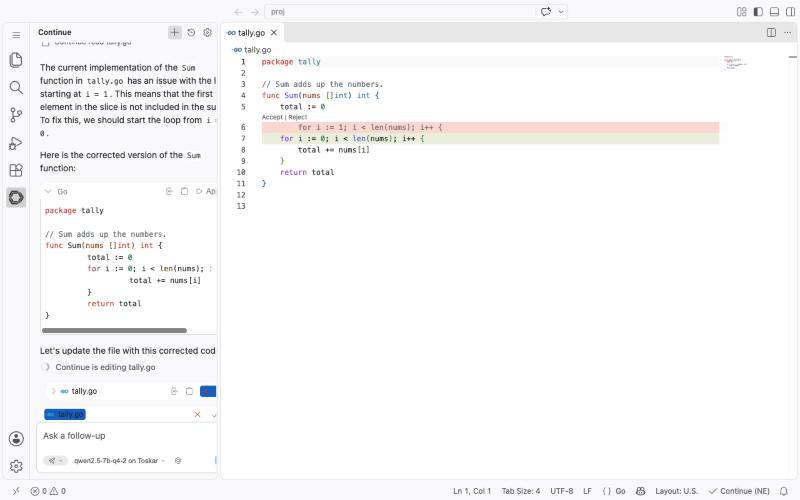
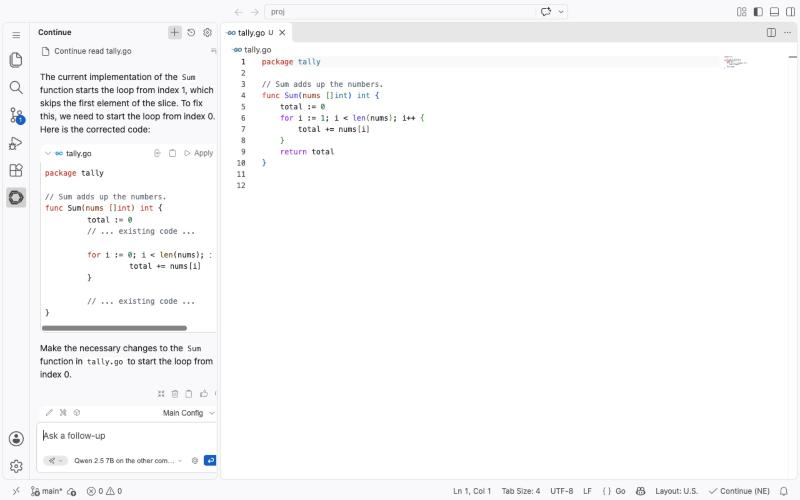

# Continue with Toskar

[Continue](https://github.com/continuedev/continue) is an open-source AI assistant for VS Code and JetBrains IDEs. With Toskar as its model provider, Continue's chat, agent mode, and edits run on a model on your own computer, or on another computer at home. No account or API key from an AI company is needed.

**Tested with** Toskar 1.12.3, Continue 2.0.0 for VS Code, VS Code 1.145.0 (its browser version, `code serve-web`), and Qwen 2.5 7B Instruct (Q4_K_M), on macOS 27.2 with an Apple M5 Pro and 24 GB of memory. JetBrains IDEs read the same settings file, but these steps haven't been checked in one yet (#1120).

## What you need

- Toskar running, with a chat model that calls tools. Qwen 2.5 7B is the one tested here ([Choosing a model](#choosing-a-model)).
- Continue, from the VS Code Marketplace or Open VSX (search "Continue"), or from JetBrains Marketplace.
- `toskarctl`, which comes with Toskar ([Command line](../cli.md)).

## Toskar on this computer

1. Print Continue's settings for Toskar:

   ```sh
   toskarctl connect continue
   ```

   It picks the best installed model for coding agents. Add `--model <id>` to choose another one.

2. Open `~/.continue/config.yaml` in any editor, and paste the printed `models:` entry. If the file is new, start it with three lines, so it looks like this:

   ```yaml
   name: Toskar
   version: 1.0.0
   schema: v1
   models:
     - name: qwen2.5-7b-q4 on Toskar
       provider: openai
       model: raw:qwen2.5-7b-q4
       apiBase: http://127.0.0.1:7331/v1
       apiKey: toskar-local
       # Toskar has no /v1/completions, so edits and Apply go through chat.
       env:
         useLegacyCompletionsEndpoint: false
       roles:
         - chat
         - edit
         - apply
       capabilities:
         - tool_use
   ```

   On this computer no key is needed, so `toskar-local` is a stand-in. The `env` lines matter: without them, Continue's edits fail (see [If it doesn't work](#if-it-doesnt-work)).

3. Continue reloads the file when it changes. Its model menu, under the chat box, now shows the model "on Toskar".

4. Ask about your code. In agent mode, Continue gives the model its tools: it reads files, proposes edits, and runs commands when you allow it. Toskar passes the tools through, and the model calls them.



Here Continue read `tally.go` with its read tool, found that the loop starts at 1, and proposed starting it at 0. The change waits in the editor until you choose Accept or Reject.

## Toskar on another computer

Use a model on a stronger computer, such as a desktop with a graphics card, from your laptop.

On the computer that runs Toskar:

1. Open API Access and turn on **Local network access**. It needs a key first, so make one.
2. Under the key's permissions, turn on **Drive models directly, for coding agents**. Only Admins can give it. Continue drives the model itself, so it needs this permission.

On the computer with your editor:

1. Print the settings with that computer's address and your key in the environment:

   ```sh
   TOSKAR_URL=http://192.168.1.20:7331 TOSKAR_API_KEY=<your key> toskarctl connect continue
   ```

   The printed entry uses `apiKey: ${{ secrets.TOSKAR_API_KEY }}`, so the key isn't written into `config.yaml`.

2. Put the key in `~/.continue/.env`, where Continue keeps secrets:

   ```text
   TOSKAR_API_KEY=<your key>
   ```

3. Paste the entry into `config.yaml` as above. Give it a name you'll recognize, such as "Qwen 2.5 7B on the desktop".



Without the key, Toskar answers `401` "authorization required". With a key that lacks the permission, it answers `403` `RAW_NOT_ALLOWED`.

## Choosing a model

- **Chat, edit, and apply** can be one model, as in the entry above. Agent mode needs one that calls tools: `toskarctl connect` picks one that does.
- **Use `raw:<model>`.** It hands the model to Continue as it is, with Continue's own tools and instructions. Toskar's profiles and `auto` answer as Toskar's own assistant, with its tools and not Continue's, so agent mode doesn't work with them ([API](../api.md)).
- **Check what it changes.** With Qwen 2.5 7B, it found the bug in all three tries. Once it guessed a wrong path (`src/tally.go`) until told where the file was, and its Apply once merged a snippet badly, dropping a `return`. Only the 7B was tried here; on a computer with the memory for one, a larger model is worth trying. Always read the change before you accept it.
- **Autocomplete isn't supported yet.** Continue's tab completion needs `/v1/completions` with fill-in-the-middle, which Toskar doesn't have (#1119). Leave the `autocomplete` role off Toskar's models.

## If it doesn't work

| What you see | What to do |
| --- | --- |
| Edits fail with "Failed to edit file … read it again", or Apply does nothing, and Continue's log shows `404` from `/v1/completions` | Add the `env:` lines with `useLegacyCompletionsEndpoint: false` to the model. `toskarctl connect continue` prints them |
| `401` "authorization required" | The model is on another computer: put the key in `~/.continue/.env`, and check that `apiKey` names it |
| `403` `RAW_NOT_ALLOWED` | Give the key **Drive models directly, for coding agents** in API Access |
| The model asks to create a file that already exists, at a made-up path | Name the file, such as "tally.go at the top of the folder", or use a larger model |
| Apply's change removes lines it shouldn't | Reject it, ask again, or use a larger model |
| Continue's panel is empty or its icon is missing in VS Code | VS Code's Restricted Mode turns extensions off in folders you haven't trusted. Choose Restricted Mode in the status bar, then Trust |
| The model menu doesn't show Toskar's model | Check that `config.yaml` starts with `name`, `version`, and `schema`, and that the entry is under `models:` |
