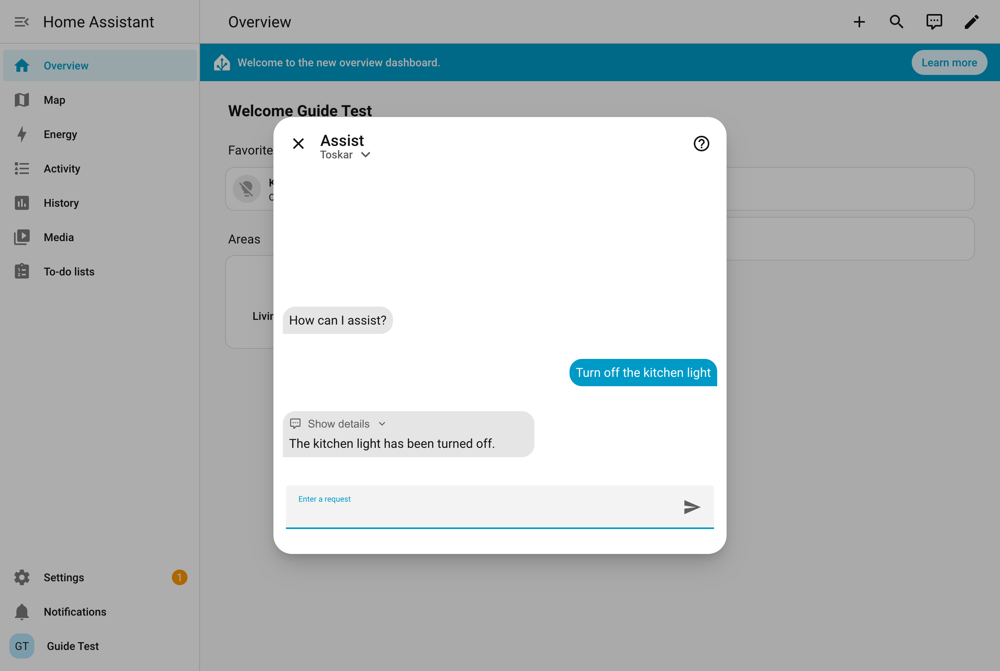

# Home Assistant with Toskar

[Home Assistant](https://www.home-assistant.io) runs your home's devices. With Toskar as the model behind its Assist voice assistant, you can talk to your home, and turn on lights, with a model on your own computers. No account or API key from an AI company is needed.

**Needs Toskar 1.15 or later.** Home Assistant reaches Toskar through its built-in **Ollama** integration, and Toskar answers Ollama's API from 1.15 (#1356). Home Assistant's own **OpenAI Conversation** can't be used: it has no setting for another server, so it only talks to OpenAI.

**Tested with** a Toskar build from before 1.15, Home Assistant 2026.11.3 in Docker Desktop 4.100.0, and Qwen 3.5 4B (Q4), on macOS 27.2 with an Apple M5 Pro and 24 GB of memory. That test used Toskar's [Ollama port](#home-assistant-that-only-looks-at-port-11434), 11434. Two changes came after it and are in 1.15: Docker's `host.docker.internal` works without a key (#1057), and Assist's tools reach auto and profiles (#1450).

## What you need

- Toskar 1.15 or later, with a chat model that calls tools. Qwen 3.5 4B is the one tested here.
- Home Assistant, in Docker on the same computer, or on its own device such as a Raspberry Pi with Home Assistant OS.

## Add Toskar as Home Assistant's Ollama

1. In Home Assistant, open **Settings › Devices & services › Add integration** and choose **Ollama**.
2. For **URL**, give Toskar's address, with no `/v1`:
   - Home Assistant in Docker on the same computer: `http://host.docker.internal:7331`. On Linux without Docker Desktop, start the container with `--add-host host.docker.internal:host-gateway`.
   - Home Assistant on another device, such as a Pi: the address that **Settings › Network access** shows once **Local network access** is on, such as `http://192.168.1.20:7331`.
3. **API key:** leave it empty on the same computer. From another device, make a key in **Settings › API keys** and paste it here.
4. Choose a model. The list starts with Toskar's, marked "(downloaded)": `auto`, a `profile:` for each profile, and `raw:` models. **Choose one of these.** Below them, Home Assistant adds Ollama's own library, such as `aya` or `bakllava`. Toskar manages its models itself, so picking one of those fails to download, and the assistant isn't made.
5. Under the model's options, set **Control Home Assistant** to **Assist**, so the model can use your devices.

## Talk to your home

1. Open **Settings › Voice assistants › Add assistant**, name it, such as "Toskar", and choose the Ollama conversation agent from above.
2. Home Assistant only lets Assist use what you expose to it. Check **Settings › Voice assistants › Expose** for the lights and switches you want.
3. Open Assist, choose your assistant, and ask, such as "Turn on the kitchen light".



For device control, the model calls Home Assistant's tools, and Home Assistant runs them.

- `raw:<model>` gives the model Home Assistant's tools and instructions as they are. It's what was tested here.
- `auto` and profiles pass the tools on too, for a request that may drive models directly. That's Home Assistant on the same computer without a key, or a key with **Drive models directly, for coding agents** turned on.
- With a key, `raw:` models need the same permission. An Admin turns it on in that key's permissions in **Settings › API keys**. Without it, `raw:` models aren't in the list.

## Home Assistant that only looks at port 11434

Ollama is usually at port 11434, and an app may only look there. **Settings › API keys › Answer on Ollama's port** makes Toskar answer there too, at `http://localhost:11434`. Quit Ollama itself first, if it's running.

- It answers on this computer only (`127.0.0.1`), so Home Assistant in Docker on this computer can use `http://host.docker.internal:11434`, but a Pi can't. From another device, use Toskar's own address, as above.
- Toskar's own address works the same way, so most setups don't need this.

## If it doesn't work

| What you see | What to do |
| --- | --- |
| "Invalid authentication" when adding the integration | Toskar turned the address away. Check that it's 1.15 or later and the URL is `host.docker.internal`, or add a key from **Settings › API keys** |
| "Unexpected error while downloading model", or the assistant has no agent | You picked a model from Ollama's library. Delete the entry and add it again, choosing one marked "(downloaded)" |
| Assist answers with text such as `intent__HassTurnOn name: Kitchen light` and nothing changes | The model's tools didn't reach it. Use `raw:<model>`, or a key with **Drive models directly** |
| Assist says it can't control a device | Expose the device in **Settings › Voice assistants › Expose**. Some kinds, such as input booleans (helpers), aren't exposed by default |
| Connection refused from a Pi on port 11434 | Toskar's Ollama port is for this computer only. Use port 7331 with a key and **Local network access** on |

## A light to try it with

With no devices yet, a template light works for a test. In `configuration.yaml`:

```yaml
input_boolean:
  porch_light:
    name: Porch light

template:
  - light:
      - name: Kitchen light
        state: "{{ is_state('input_boolean.porch_light', 'on') }}"
        turn_on:
          - action: input_boolean.turn_on
            target:
              entity_id: input_boolean.porch_light
        turn_off:
          - action: input_boolean.turn_off
            target:
              entity_id: input_boolean.porch_light
```

The older `light: - platform: template` form is an error in Home Assistant 2026.11.

## Toskar using Home Assistant

The other way round, Toskar can read and control Home Assistant itself, in **Settings › Connected services**, with a long-lived token from Home Assistant ([Tools](../tools.md)). That wasn't part of this test.
