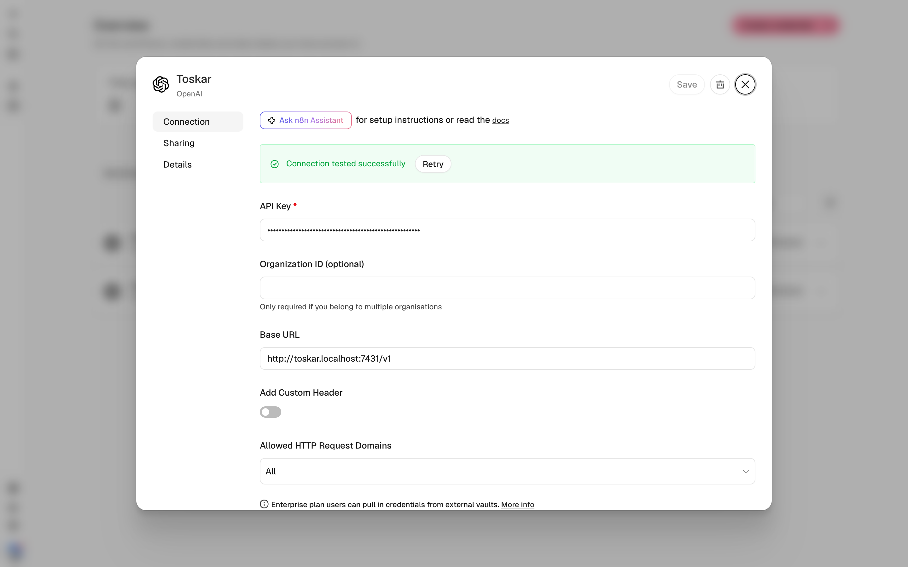
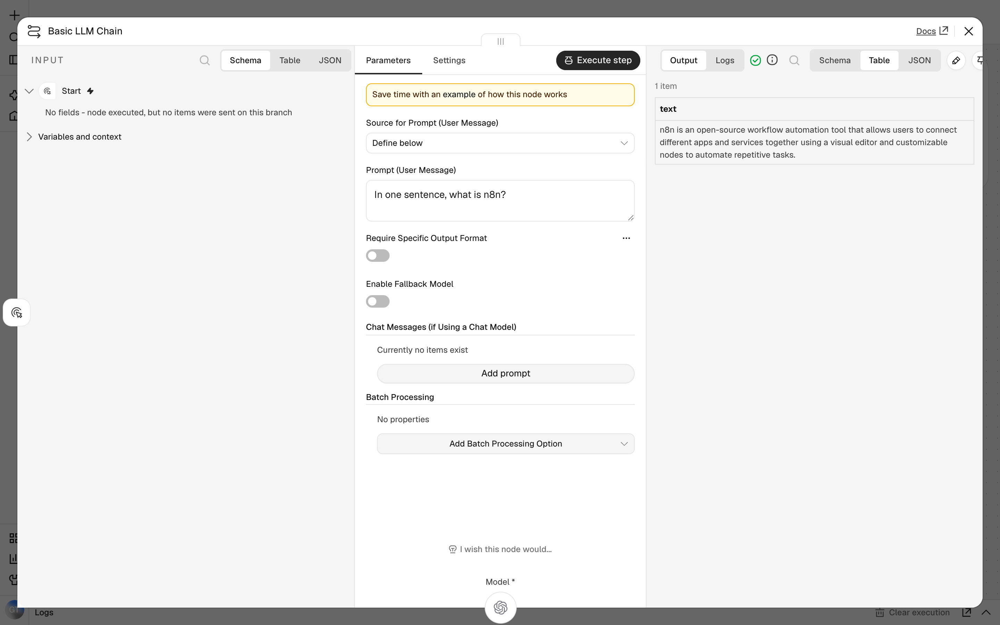
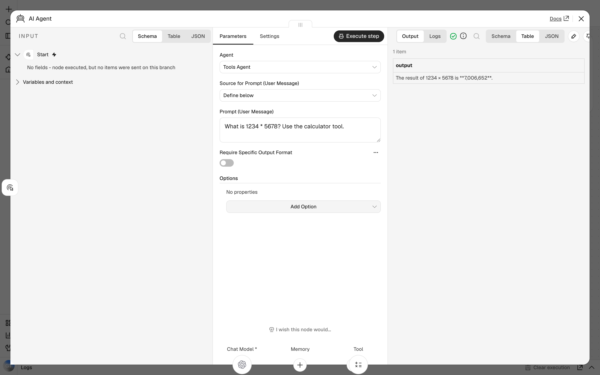
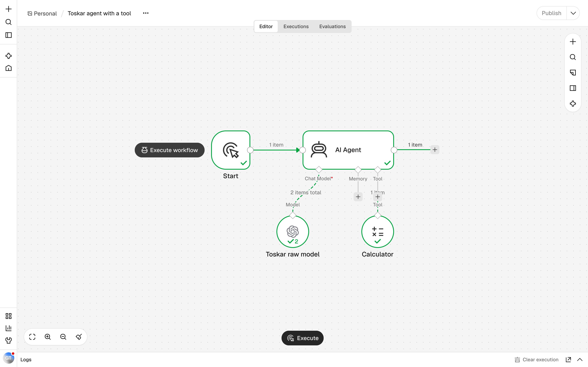

# n8n with Toskar

[n8n](https://n8n.io) builds automations from nodes. With Toskar as the OpenAI credential, its AI nodes, such as Basic LLM Chain and AI Agent, run on models on your own computers. No account or API key from an AI company is needed.

**Tested with** Toskar 1.14.2, n8n 2.49.6 in Docker Desktop 4.100.0, and Qwen 3.5 4B (Q4), on macOS 27.2 with an Apple M5 Pro and 24 GB of memory. The test copy of Toskar used port 7431; yours is on 7331, as below. Two things changed after 1.14.2 and are marked **1.15**: Docker's `host.docker.internal` works without a key (#1057), and an AI Agent's tools reach auto and profiles (#1450).

## What you need

- Toskar running, with a chat model that calls tools for agents. Qwen 3.5 4B is the one tested here.
- n8n. In Docker:

  ```sh
  docker run -d --name n8n -p 127.0.0.1:5678:5678 \
    -v n8n_data:/home/node/.n8n \
    docker.n8n.io/n8nio/n8n:latest
  ```

  On Linux without Docker Desktop, add `--add-host host.docker.internal:host-gateway`.

## Add Toskar as a credential

1. In n8n, open **Credentials › Add credential** and choose **OpenAI**.
2. Fill it in:
   - **API Key:** on this computer no key is needed, but n8n wants one, so type a stand-in such as `toskar-local`. For Toskar on another computer, use a key from **Settings › API keys**, and turn on **Local network access** in **Settings › Network access** there.
   - **Base URL:** `http://host.docker.internal:7331/v1` when n8n is in Docker on this computer, `http://127.0.0.1:7331/v1` when n8n runs on the computer itself, or the other computer's address, such as `http://192.168.1.20:7331/v1`.
3. Choose **Save**. n8n tests the connection.



The test copy here used `toskar.localhost` as the address, as in [Toskar 1.14.2](#toskar-1142) below.

## Ask a model: Basic LLM Chain

1. Add a trigger, such as **Manual Trigger**, then a **Basic LLM Chain** node.
2. Under the chain, add an **OpenAI Chat Model** with the Toskar credential.
3. For **Model**, choose **By ID** and type `auto`, or a profile such as `profile:general-assistant`. These answer with Toskar's assistant, with memories, knowledge, look-ups and answer checks.



## Use tools: AI Agent

An AI Agent gives the model n8n's tools, such as **Calculator**, and runs the ones the model calls.

1. Add an **AI Agent** node, an **OpenAI Chat Model** with the Toskar credential, and a tool, such as **Calculator**.
2. For **Model**, type `raw:<model id>`, such as `raw:qwen3.5-4b-q4`. That's the model itself, with n8n's tools and instructions. **1.15:** `auto` or a profile works too, with n8n's tools reaching the model that turn uses.

Asked "What is 1234 × 5678?", the model called Calculator, which worked it out, and answered with its result.





With a key, `raw:` models and an agent's tools need the key's **Drive models directly, for coding agents** permission, which an Admin turns on in **Settings › API keys**. On this computer without a key, nothing is needed.

## Toskar 1.14.2

Without a key, Toskar 1.14.2 turns `host.docker.internal` away with `403 HOST_NOT_ALLOWED`. Either use a key, or give the container a `.localhost` name for this computer: add `--add-host toskar.localhost:192.168.65.254` (Docker Desktop's address for the computer) to `docker run`, and use `http://toskar.localhost:7331/v1` as the Base URL.

With 1.14.2, an AI Agent's tools reach only `raw:` models. With `auto` or a profile, Toskar uses its own tools instead, and n8n's are left out.

## If it doesn't work

| What you see | What to do |
| --- | --- |
| The credential test fails with `403` `HOST_NOT_ALLOWED` | Toskar 1.14.2 with no key: use a key or the `toskar.localhost` name ([Toskar 1.14.2](#toskar-1142)) |
| `401` "authorization required" | Toskar is on another computer: use a real key from its **Settings › API keys** |
| `403` `RAW_NOT_ALLOWED` | Give the key **Drive models directly, for coding agents** |
| The agent answers without running its tool | Use `raw:<model id>` (or `auto` on 1.15), and a model that calls tools |
| The model list in n8n doesn't show Toskar's models | Choose **By ID** and type the id, such as `auto` or `raw:qwen3.5-4b-q4` |

On this computer, Toskar doesn't check the key, so a mistyped key works there but not from another computer.
