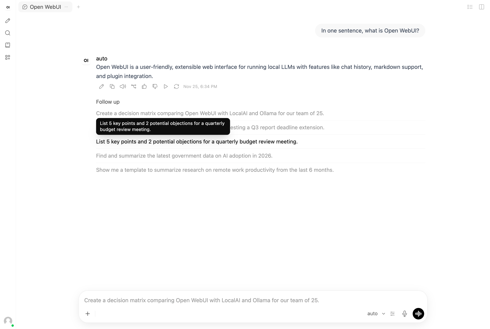
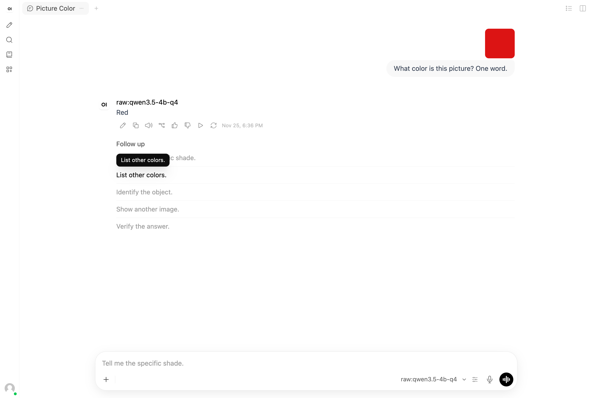
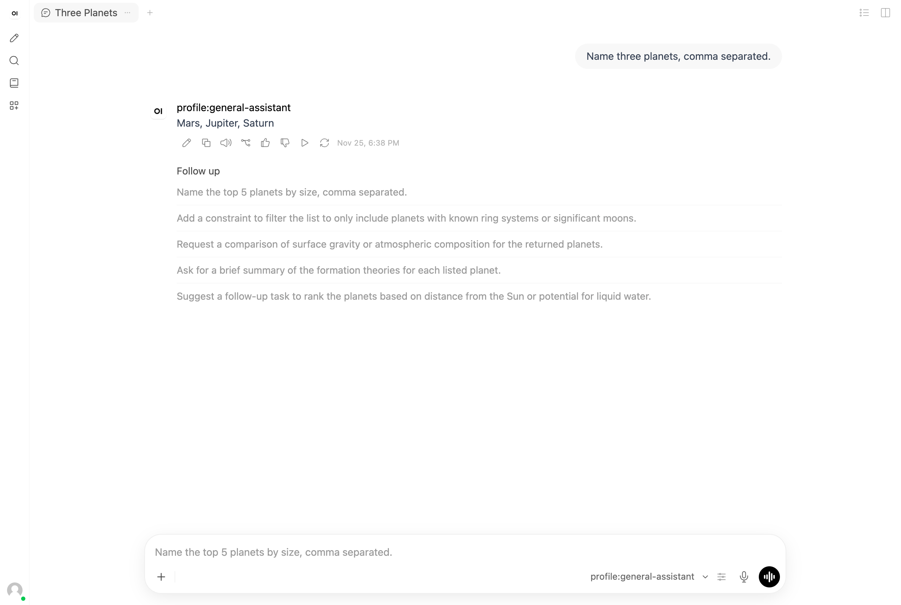

# Open WebUI with Toskar

[Open WebUI](https://github.com/open-webui/open-webui) is a self-hosted chat app that runs in a browser. With Toskar as its OpenAI connection, its chats, pictures and tools are answered by models on your own computers. No account or API key from an AI company is needed.

**Tested with** Toskar 1.14.2, Open WebUI 0.13.5 in Docker Desktop 4.100.0, and Qwen 3.5 4B (Q4), on macOS 27.2 with an Apple M5 Pro and 24 GB of memory. The test copy of Toskar used port 7431; yours is on 7331, as below. Three things changed after 1.14.2 and are marked **1.15** in this guide: Docker's `host.docker.internal` works without a key (#1057), auto and profile answers stream as they're written, and Open WebUI's own tools reach auto and profiles (#1450).

## What you need

- Toskar running, with a chat model installed.
- Docker, such as Docker Desktop, for Open WebUI. Its other ways of installing work too: only the address changes ([Open WebUI not in Docker](#open-webui-not-in-docker)).

## Toskar on this computer

1. Start Open WebUI with Toskar as its OpenAI connection:

   ```sh
   docker run -d --name open-webui -p 127.0.0.1:3000:8080 \
     -e ENABLE_OLLAMA_API=False \
     -e ENABLE_PERSISTENT_CONFIG=False \
     -e OPENAI_API_BASE_URL=http://host.docker.internal:7331/v1 \
     -e OPENAI_API_KEY=toskar-local \
     -v open-webui:/app/backend/data \
     ghcr.io/open-webui/open-webui:main
   ```

   - On this computer no key is needed, so `toskar-local` is a stand-in.
   - `ENABLE_PERSISTENT_CONFIG=False` makes Open WebUI read the connection from these lines each time it starts. Without it, Open WebUI keeps the first connection it was given and ignores later changes here. To set the connection in Open WebUI instead, leave the line out and use **Admin Panel › Settings › Connections**.
   - On Linux without Docker Desktop, add `--add-host host.docker.internal:host-gateway`.

2. Open http://localhost:3000 and make Open WebUI's admin account, which stays in Open WebUI.

3. The model menu lists Toskar's models: `auto`, a `profile:` for each profile, and `raw:` for each installed model.
   - `auto` and the profiles answer with Toskar's assistant: memories, knowledge, look-ups and answer checks.
   - `raw:<model>` is the model itself, with only what Open WebUI sends.



Pictures work too. Attach one and ask about it, with `auto` or with a `raw:` model that sees pictures, such as Qwen 3.5.



**Toskar 1.14.2:** without a key, Toskar turns `host.docker.internal` away and Open WebUI's model menu is empty, with no error shown. Use a key ([Toskar on another computer](#toskar-on-another-computer), steps 1 and 3, with `host.docker.internal` as the address), or give the container a `.localhost` name for this computer: add `--add-host toskar.localhost:192.168.65.254` (Docker Desktop's address for the computer) and use `http://toskar.localhost:7331/v1`.

## Toskar on another computer

Use the models on a stronger computer, such as a desktop with a graphics card, from Open WebUI somewhere else.

On the computer that runs Toskar:

1. In **Settings › API keys**, make a key for Open WebUI and copy its secret.
2. In **Settings › Network access**, turn on **Local network access**, and note the address it shows, such as `192.168.1.20`.

Where Open WebUI runs:

3. Start Open WebUI as above, with that address and the key:

   ```sh
   -e OPENAI_API_BASE_URL=http://192.168.1.20:7331/v1 \
   -e OPENAI_API_KEY=<your key> \
   ```



A new key lists `auto` and the profiles, but no `raw:` models. A raw model skips the profile's tools, checks and topic limits, so an Admin gives it key by key: turn on **Drive models directly, for coding agents** in the key's permissions. The same permission lets Open WebUI's own tools reach auto and profiles (**1.15**).

## Tools

Open WebUI can give the model its own tools, such as ones you add in **Workspace › Tools**.

- With `raw:<model>`, the model calls Open WebUI's tools.
- With `auto` or a profile, Toskar uses its own tools, such as web search, unless the request may drive models directly. **1.15:** then Open WebUI's tools reach the model that turn uses. That's any request from this computer without a key, and a key with **Drive models directly** turned on.

## Open WebUI not in Docker

Installed with `pip` or `uv`, Open WebUI runs on the computer itself. Use `http://127.0.0.1:7331/v1` as the address, and set the connection in **Admin Panel › Settings › Connections**.

## If it doesn't work

| What you see | What to do |
| --- | --- |
| The model menu is empty, with no error | Toskar 1.14.2 turns `host.docker.internal` away without a key. Use a key, or the `toskar.localhost` name above. On another computer, check that the address and key are right: Open WebUI doesn't show Toskar's error |
| Changing `OPENAI_API_BASE_URL` does nothing | Add `ENABLE_PERSISTENT_CONFIG=False`, or change the connection in **Admin Panel › Settings › Connections** |
| No `raw:` models with a key | Give the key **Drive models directly, for coding agents** in **Settings › API keys** |
| `403` `RAW_NOT_ALLOWED` | The same: the key may not use `raw:` models yet |
| With 1.14.2, auto's answer appears all at once after a wait | auto and profile answers arrive in one piece before 1.15. `raw:` models stream as they're written |
| Open WebUI's tool isn't used | Use `raw:<model>`, or on 1.15 a request that may drive models directly ([Tools](#tools)) |

Open WebUI also sends its own short requests, for a chat's title and suggested follow-ups, to the same model. They're normal and need nothing set.
